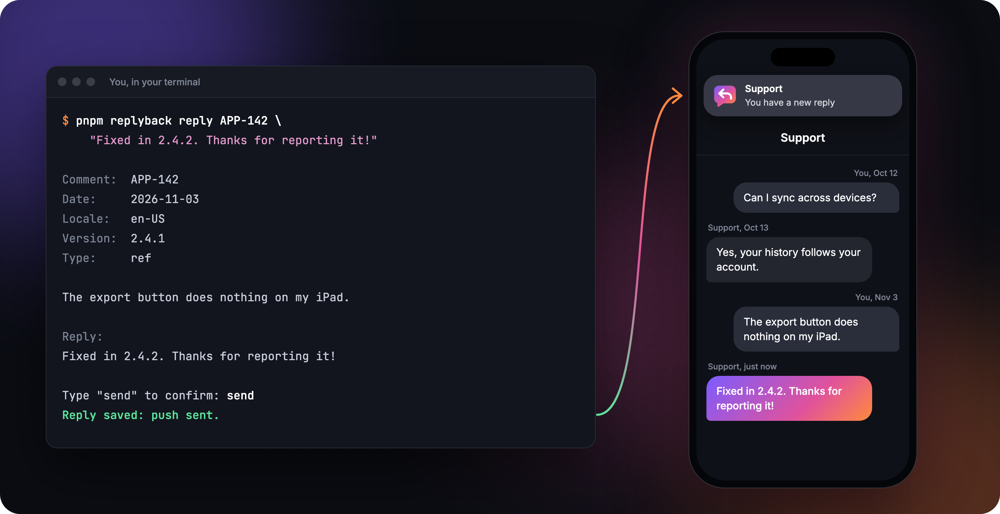
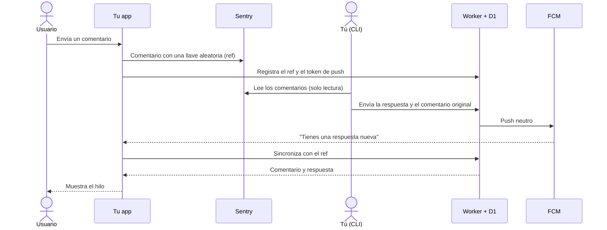

<p align="center">
  <picture>
    <source media="(prefers-color-scheme: dark)" srcset="assets/logo-wordmark-dark.svg">
    
  </picture>
</p>

<h3 align="center">Responde dentro de tu app a los comentarios que los usuarios envían por Sentry.</h3>

<p align="center">
  <a href="https://github.com/WilderLopez/replyback/actions/workflows/ci.yml"></a>
  <a href="LICENSE"></a>
  
  
  
</p>

<p align="center">
  <a href="docs/DEPLOY.md">Desplegar</a> ·
  <a href="docs/INTEGRATION-IOS.md">Integrar en iOS</a> ·
  <a href="docs/API.md">API</a> ·
  <a href="README.md">English</a>
</p>

<p align="center">
  
</p>
<p align="center"><sub>Ilustración con datos inventados. El SDK no trae interfaz: la pantalla es tuya.</sub></p>

Sentry recoge los comentarios, pero no ofrece un canal para contestar. replyback añade ese canal sin tocar
el backend de tu app y sin correo: respondes desde una CLI, un Cloudflare Worker guarda la respuesta y avisa
con un push, y la app muestra el comentario y su respuesta como un hilo.

> [!NOTE]
> Proyecto en fase temprana: el SDK de iOS se probó en un iPhone real, pero aún no ha salido en una versión de
> la App Store. Android no tiene SDK, solo una [API documentada](docs/API.md).

## Cómo funciona



## Qué incluye

- **Hilos en tu app:** cada comentario con sus respuestas, y un estado de "esperando respuesta".
- **Sin costo al empezar:** debería caber en los planes gratuitos de Cloudflare y Firebase.
- **Un despliegue por proyecto:** tu propio Worker, base de datos y secretos, sin servidor central.
- **Sin cambios en tu backend:** el Worker nunca lo llama.
- **También para comentarios antiguos:** en iOS se pueden responder los enviados antes de integrar el SDK.

## Un vistazo al SDK

Sin dependencias, ni siquiera de Sentry, y sin interfaz, así que los hilos se ven como el resto de tu app.

```swift
import Replyback

// Tu formulario: añade la llave y envía a Sentry como siempre.
let message = Support.client.prepareComment(text)
SentrySDK.capture(feedback: SentryFeedback(message: message, name: name, email: email, source: .custom))
await Support.client.sync(fcmToken: token)

// Tu pantalla de soporte.
ForEach(Support.client.threads) { thread in
    Text(thread.comment ?? "")
    ForEach(thread.replies) { reply in
        Text(reply.text)
    }
}
```

## Datos

| Dato | Dónde vive |
|---|---|
| Comentario, respuesta, ID de usuario, token de push | Tu cuenta de Cloudflare, se borran tras 2 años sin actividad |
| Llaves para leerlos (`ref`) | Llavero de iCloud del dispositivo, por cuenta |
| Copia local de los hilos | Caché de la app, fuera de las copias de seguridad |
| Correo | replyback nunca lo guarda |

> [!IMPORTANT]
> Estos datos pasan a ser tu responsabilidad. Comprueba que tu política de privacidad los cubre, y llama a
> `deleteAllData()` en tu flujo de eliminar cuenta.

## Cómo empezar

Las guías detalladas están en inglés:

1. [Desplegar el Worker y configurar la CLI](docs/DEPLOY.md).
2. [Integrar el SDK de iOS](docs/INTEGRATION-IOS.md), o implementar la [API](docs/API.md) en otra plataforma.
3. Responder a tus usuarios:

```sh
pnpm replyback --deployment mi-app list --pending
pnpm replyback --deployment mi-app show PROYECTO-123
pnpm replyback --deployment mi-app reply PROYECTO-123 "Ya está corregido, gracias por avisar."
```

## Límites conocidos

- **Detector de spam de Sentry:** puede archivar comentarios reales por su cuenta, sin enviar alertas. Usa
  `replyback list`, que los marca como `[archived]`.
- **Sentry tarda unos minutos** en mostrar un comentario nuevo.
- **Las llaves dependen del Llavero de iCloud:** sin él, o al pasar a otro Apple ID o a Android, el usuario pierde
  el acceso a su historial.
- **Los comentarios sin responder son locales:** la CLI sube el comentario al responder, así que uno sin
  respuesta no aparece en otro dispositivo.

Las decisiones de diseño están en [docs/diseno.md](docs/diseno.md).

## Licencia

[MIT](LICENSE)
