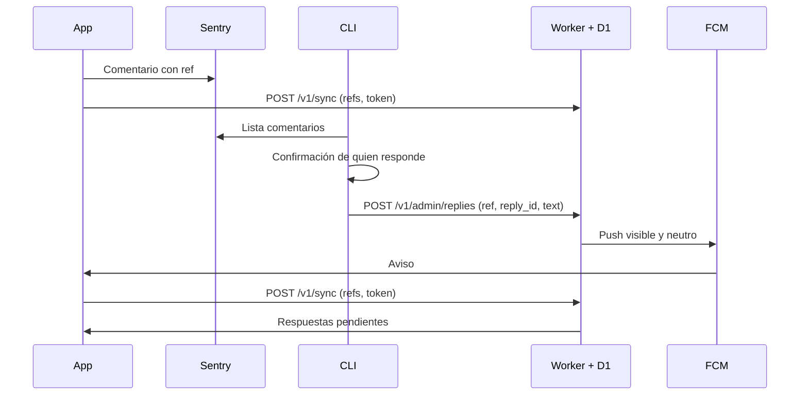

# Diseño

Volver a [Inicio](Inicio.md).

## Piezas

| Pieza | Qué hace |
|---|---|
| **SDK de la app** | Genera la referencia, la añade al comentario, sincroniza y entrega las respuestas a la app. |
| **Sentry** | Recibe el comentario, igual que hoy. replyback solo lo lee. |
| **CLI** | Lista comentarios, muestra el detalle y envía respuestas tras pedir confirmación. |
| **Worker + D1** | Guarda respuestas y tokens, envía el push y atiende a la app. |
| **FCM** | Entrega el push en iOS y Android. |

Más adelante, un backoffice puede sustituir a la CLI llamando al mismo endpoint de administración.

## Flujo



## Decisiones

### Una referencia aleatoria como clave

Cada comentario lleva un UUID (`ref`) generado por la app e incluido en el mensaje que llega a
Sentry, por ejemplo con una línea `ref:<uuid>`.

No se usa el ID del usuario como clave. El Worker es público, y con esa clave cualquiera que
conociera un ID podría registrar su propio token y pedir respuestas ajenas. El `ref` hace de
secreto: solo lo conocen la app que lo creó y quien lee el comentario en Sentry.

Tampoco se usa el `eventId` que genera el SDK de Sentry: en sentry-cocoa está marcado como API
privada (`@_spi(Private)`).

### Un push visible, más consulta al abrir

El push visible avisa y la consulta entrega. Ni la respuesta ni el `ref` viajan en el push: el `ref`
da acceso a la respuesta. El texto es neutro y configurable, y admite claves de traducción que la app
resuelve en el dispositivo.

No se usan pushes silenciosos como único mecanismo, porque iOS los limita y no los entrega si el
usuario cerró la app a la fuerza. Si el push se pierde, la respuesta llega igual la siguiente
vez que se abra la app.

La app solo consulta si tiene comentarios sin responder. Así casi ningún usuario gasta peticiones.

### CLI en lugar de webhook

Con una herramienta local no hace falta el webhook de comentarios de Sentry, ni un prefijo para
distinguir comentarios internos de respuestas. Tampoco importa cómo agrupe Sentry los
comentarios, porque se responde por `ref` y no por issue.

Se empieza con una CLI porque se usa a mano y desde un agente, y es fácil de reemplazar. Si hace
falta, un MCP puede envolver los mismos comandos.

### D1 y no KV

En KV un cambio puede tardar 60 segundos o más en verse desde otras regiones, y también se
cachean las lecturas de claves inexistentes. La app podría preguntar justo al recibir el push y
no encontrar nada.

### Un despliegue por proyecto

Cada proyecto tiene su Worker, su base D1 y sus secretos. Los datos no se mezclan y no hay un
servidor central.

### El Worker como fuente de verdad

El comentario original viaja con la respuesta y se guarda en el Worker, junto con el histórico. Así
los hilos no dependen del dispositivo, los comentarios antiguos también muestran su original y los
datos quedan listos para migrar a un sistema mayor.

El Worker también guarda el `user_id` del evento de Sentry, para saber de qué cuenta es cada comentario,
migrar y borrar datos aunque se hayan perdido las llaves. Lo envía la CLI y nunca se devuelve a la app.

Son datos personales en la nube, y sin caducidad. Por eso existen `POST /v1/delete` y
`POST /v1/admin/delete`, y cada proyecto debe reflejarlo en su política de privacidad.

El comentario lo envía la CLI al responder, no la app. Una ruta pública que aceptara texto libre
permitiría llenar la base de datos. Por eso un comentario sin responder solo existe como copia local,
y no aparece en otro teléfono hasta que tenga respuesta.

### Las llaves en el Llavero

Sin el `ref` no se pueden leer los datos, así que tener el comentario en la nube no basta para cambiar
de teléfono. Los `ref` se guardan en el Llavero con sincronización de iCloud: sobreviven a reinstalar
la app y pasan a otro iPhone con el mismo Apple ID, si el usuario tiene activado el Llavero de iCloud.

Se guardan por cuenta. Al cerrar sesión los datos se ocultan sin borrarse, y otra cuenta en el mismo
teléfono no los ve.

### Sin correo

La respuesta se entrega dentro de la app. El envío de correo de Cloudflare a destinatarios
arbitrarios exige Workers Paid, y prescindir del correo evita tocar la configuración del dominio
de cada proyecto.

## API

### `POST /v1/sync` (pública)

La llama la app al enviar un comentario, al abrir o volver a primer plano con comentarios
pendientes, y al recibir el push.

```json
{ "refs": ["<uuid>"], "fcm_token": "<token, opcional>" }
```

```json
{
  "replies": [
    {
      "ref": "<uuid>",
      "reply_id": "<uuid>",
      "text": "...",
      "comment": "...",
      "comment_at": 0,
      "created_at": 0,
      "delivered_at": null
    }
  ]
}
```

Registra o actualiza el token de cada `ref` y devuelve sus respuestas. Una sola ruta cubre el
registro, el cambio de token y la recogida.

### `POST /v1/admin/replies` (con `ADMIN_TOKEN`)

```json
{ "ref": "<uuid>", "reply_id": "<uuid>", "text": "...", "comment": "...", "comment_at": 0, "user_id": "<id>" }
```

Guarda la respuesta y envía el push. La clave `reply_id` la genera quien llama, de modo que
reintentar tras un fallo de red no duplica ni la respuesta ni el aviso. Si el push falló, repetir la
petición lo reintenta, salvo que la respuesta ya se haya entregado.

```json
{ "status": "stored", "push": "sent" }
```

`status` es `stored` o `duplicate`. `push` es `sent`, `no_token`, `failed`, `invalid_token`,
`not_configured`, `already_sent` o `already_delivered`. Un fallo del push no hace fallar la petición,
porque la respuesta ya está guardada.

Si el `ref` todavía no tiene token, la respuesta queda guardada y se entrega en el siguiente
`sync`.

### `POST /v1/admin/delete` (con `ADMIN_TOKEN`)

```json
{ "user_id": "<id>" }
```

Borra las respuestas y los tokens de una cuenta, también si se perdieron sus llaves.

### `POST /v1/delete` (pública)

```json
{ "refs": ["<uuid>"] }
```

Borra las respuestas y el token de esos `ref`. Quien tiene un `ref` puede leer sus datos, y también
borrarlos. La app lo usa al eliminar la cuenta.

## Comentarios antiguos

Función opcional, solo para iOS con sentry-cocoa, para responder a comentarios enviados antes de
integrar el SDK, que no tienen `ref` ni token.

El evento de Sentry incluye `device_app_hash`, un valor que el SDK calcula en el propio dispositivo y
que otros usuarios no conocen. Junto con el ID de usuario permite derivar el mismo `ref` en la CLI y
en la app, sin endpoints nuevos, sin sesión y sin llamar al backend del proyecto.

```text
device_app_hash = SHA1(bytes de identifierForVendor + hw.machine + hw.model + bundle ID)
ref antiguo     = SHA256("replyback:" + user_id + ":" + device_app_hash), con formato de UUID
```

### Flujo

1. La CLI lee `user_id` y `device_app_hash` del evento, deriva el `ref` y responde con el
   `POST /v1/admin/replies` de siempre. Como no hay token, la respuesta queda guardada.
2. La app, una vez por cuenta y versión, calcula su `ref` antiguo y lo consulta con `sync`, **sin enviar
   token**. Así el Worker no guarda nada de quien no tenga respuesta.
3. Si hay respuesta, la app la muestra como cualquier otra.

### Por qué es seguro

- El ID de usuario no es secreto, pero `identifierForVendor` sí: solo lo conocen el dispositivo y, a
  través del hash, Sentry. Sin él no se puede calcular el `ref`.
- Incluir el ID de usuario evita que otra cuenta en el mismo teléfono vea la respuesta.
- Al Worker llega el `ref`, nunca el identificador del dispositivo ni el ID de usuario.

### Límites

- No hay push, porque no hay token: el usuario ve la respuesta al abrir una versión con el SDK.
- No llega a quien no actualice o haya desinstalado la app.
- Se consulta una vez por cuenta y versión: una respuesta enviada después de esa consulta espera a la
  siguiente versión. Por eso conviene cargarlas antes de publicar.
- Solo funciona en el mismo teléfono y con la misma cuenta. `identifierForVendor` cambia si el usuario
  borra todas las apps del mismo desarrollador y reinstala.
- Dos comentarios de la misma persona en el mismo teléfono comparten `ref`: las respuestas de ambos llegan
  juntas, y al responder uno, la CLI muestra el otro como respondido.
- Depende de cómo sentry-cocoa calcula el hash, así que es una solución de una sola vez, no un
  mecanismo permanente. Las respuestas sin recoger caducan como las demás.

## Datos

```sql
CREATE TABLE tokens (
  ref TEXT PRIMARY KEY,
  fcm_token TEXT NOT NULL,
  updated_at INTEGER NOT NULL
);

CREATE TABLE replies (
  reply_id TEXT PRIMARY KEY,
  ref TEXT NOT NULL,
  text TEXT NOT NULL,
  created_at INTEGER NOT NULL,
  comment TEXT,
  comment_at INTEGER,
  user_id TEXT,
  pushed_at INTEGER,
  delivered_at INTEGER
);

CREATE INDEX replies_ref ON replies(ref);
CREATE INDEX replies_user_id ON replies(user_id);
```

El comentario va en cada respuesta y no por `ref`, porque dos comentarios antiguos de la misma persona y
teléfono comparten `ref`.

El histórico no caduca: solo se borra con `POST /v1/delete`. Un Cron Trigger borra a diario los tokens
sin actividad en 180 días que no tengan respuestas pendientes.

## CLI

```text
replyback [--deployment <nombre>] list [--pending] [--all]
replyback [--deployment <nombre>] show <issue>
replyback [--deployment <nombre>] reply <issue> "Texto de la respuesta" [--yes]
replyback [--deployment <nombre>] reply <issue> --file <ruta> [--yes]
replyback [--deployment <nombre>] forget <issue> [--yes]
```

`<issue>` es el ID corto de Sentry. La CLI se niega a responder si el issue agrupa más de un evento,
porque la respuesta podría llegar a otra persona. `reply` saca el `ref` del mensaje y, si no lo hay, lo
deriva como se explica en [Comentarios antiguos](#comentarios-antiguos). Muestra el texto final y el destino, sin datos personales, y pide confirmación antes de
enviar. Para Sentry usa un token de solo lectura, y para el Worker el `ADMIN_TOKEN`. Ambos se
guardan fuera del repo, en variables de entorno o en `deployments/<nombre>/.env`.

Sin terminal y sin `--yes`, `reply` muestra lo que enviaría y se detiene. El `reply_id` se deriva del
`ref` y del texto, así que repetir el mismo comando no duplica nada.

El estado de cada comentario sale de `POST /v1/admin/replies/status`, con `ADMIN_TOKEN`.

## SDK de la app

Primero en Swift, sin dependencias: ni siquiera de Sentry. Android se añade cuando haga falta, usando
el mismo contrato.

| Momento | Llamada |
|---|---|
| Al iniciar y cerrar sesión | `setAccount(userID:)`, con `nil` al cerrar |
| Al enviar un comentario | `prepareComment(_:)` da el mensaje para Sentry, y después `sync(fcmToken:)` |
| Al abrir o volver a primer plano | `syncIfNeeded(fcmToken:)` y `checkLegacyReplies()` |
| Al recibir el push | `isReplyNotification(_:)` lo identifica, y después `sync(fcmToken:)` |
| Al leer una respuesta | `markRead(replyID:)` |
| Al eliminar la cuenta | `deleteAllData()` |

`syncIfNeeded` solo consulta los comentarios sin responder, salvo que haya cambiado el token: entonces lo
actualiza en todos los hilos, para que una segunda respuesta a un hilo ya respondido también avise.

`threads` y `unreadCount` son observables. Cada hilo es un comentario con sus respuestas, de la más
antigua a la más reciente, y los hilos van de mayor a menor actividad. La caché se guarda en un fichero
por cuenta, excluido de las copias de seguridad. La app pone la pantalla, los textos y la navegación
desde el push.

Los fallos de red no se propagan como errores: las llamadas devuelven `false` y se reintenta en la
siguiente consulta. Una consulta en curso de otra cuenta no mezcla datos.

## Seguridad y límites

- `/v1/sync` valida el formato de los UUID, limita cuántos acepta por llamada y lleva un rate limit.
- El push no incluye el texto de la respuesta.
- La cuenta de servicio de Firebase se guarda como secreto del Worker.
- Sin el Llavero de iCloud activado, o al pasar a otro Apple ID o a Android, se pierden los `ref`, y con
  ellos el acceso al histórico.
- El estado de leído es local: al recuperar el histórico en otro teléfono, lo ya entregado cuenta como leído.
- Los comentarios enviados antes de integrar el SDK se responden como se explica en
  [Comentarios antiguos](#comentarios-antiguos).
- La cuota gratuita de Workers y D1 es por cuenta de Cloudflare, así que se comparte con todo lo
  que viva en esa cuenta.

## Qué se observó en Sentry

Comprobado con comentarios reales del proyecto piloto:

- **Listado:** `issue.category:feedback` devuelve los comentarios.
- **Un issue por comentario:** en una muestra de 25, todos tenían un solo evento y un solo usuario.
  No es una garantía, pero el diseño tampoco depende de ello, porque se responde por `ref`.
- **Dónde está el texto:** el mensaje completo llega en `contexts.feedback.message`, con sus saltos
  de línea. El título del issue es un resumen generado por IA, a menudo traducido, y no sirve como
  fuente.
- **Etiquetas:** el evento incluye las del scope del SDK, así que `ref` también podría viajar como
  etiqueta si la línea en el mensaje da problemas.
- **Spam:** Sentry puede archivar por su cuenta un comentario que clasifica como spam, y entonces no
  aparece con `is:unresolved`. Le pasó a un comentario de prueba que decía "por favor ignorar", aunque
  Sentry no indica el motivo. Por eso la CLI consulta `!is:resolved` y los marca como archivados.
- **Quién ve el `ref`:** va en el mensaje, así que lo ven quienes acceden al proyecto de Sentry y puede
  aparecer en el título del issue.
- **Idioma:** `contexts.culture.locale` indica en qué idioma conviene responder.
- **Cuota:** entraron comentarios mientras los errores se rechazaban por cuota agotada, con cero
  errores aceptados en esos días. Todo apunta a que el feedback no depende de esa cuota, aunque la
  documentación de Sentry no lo aclara.

El evento también contiene correo e ID de usuario. La CLI no los muestra, porque no los necesita.

## Por comprobar

- [x] El `ref` llega intacto en `contexts.feedback.message`, con un comentario enviado desde un iPhone real.
- [x] La CLI lee comentarios reales de la API de Sentry con un token de solo lectura: ID corto, texto, idioma, versión y `ref` derivado.
- [x] Firmar el acceso a FCM cabe en los 10 ms de CPU del plan gratuito: 40 envíos seguidos llegaron a FCM, y el máximo fue 6 ms en los 17 que registró `wrangler tail`.
- [ ] El push llega y abre la respuesta con la app cerrada a la fuerza.
- [ ] Los `ref` del Llavero sobreviven a reinstalar y pasan a otro iPhone con el mismo Apple ID.
- [x] El `device_app_hash` calculado por la app coincide con el valor de sentry-cocoa en un iPhone real.
- [ ] Ese valor coincide con el de un evento ya guardado en Sentry para ese mismo iPhone. No hay ninguno todavía; en otros eventos, la etiqueta `app.device` y `contexts.app.device_app_hash` son iguales.
- [x] La fórmula de `device_app_hash` es estable: según el historial de sentry-cocoa, esas líneas no cambian en los commits recientes.
- [ ] `sync` acepta consultas sin token y no guarda nada en ese caso.
